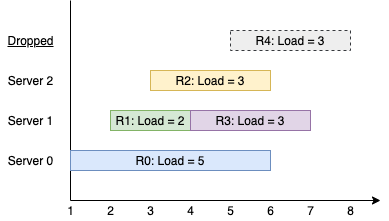

# [1606.Find Servers That Handled Most Number of Requests][title]

## Description
You have k servers numbered from `0` to `k-1` that are being used to handle multiple requests simultaneously. Each server has infinite computational capacity but **cannot handle more than one request at a time**. The requests are assigned to servers according to a specific algorithm:

- The `ith` (0-indexed) request arrives.
- If all servers are busy, the request is dropped (not handled at all).
- If the `(i % k)th` server is available, assign the request to that server.
- Otherwise, assign the request to the next available server (wrapping around the list of servers and starting from 0 if necessary). For example, if the `ith` server is busy, try to assign the request to the `(i+1)th` server, then the `(i+2)th` server, and so on.

You are given a **strictly increasing** array `arrival` of positive integers, where `arrival[i]` represents the arrival time of the `ith` request, and another array `load`, where `load[i]` represents the load of the `ith` request (the time it takes to complete). Your goal is to find the **busiest server(s)**. A server is considered **busiest** if it handled the most number of requests successfully among all the servers.

Return a list containing the IDs (0-indexed) of the **busiest server(s)**. You may return the IDs in any order.

**Example 1:**  



```
Input: k = 3, arrival = [1,2,3,4,5], load = [5,2,3,3,3] 
Output: [1] 
Explanation: 
All of the servers start out available.
The first 3 requests are handled by the first 3 servers in order.
Request 3 comes in. Server 0 is busy, so it's assigned to the next available server, which is 1.
Request 4 comes in. It cannot be handled since all servers are busy, so it is dropped.
Servers 0 and 2 handled one request each, while server 1 handled two requests. Hence server 1 is the busiest server.
```

**Example 2:**

```
Input: k = 3, arrival = [1,2,3,4], load = [1,2,1,2]
Output: [0]
Explanation: 
The first 3 requests are handled by first 3 servers.
Request 3 comes in. It is handled by server 0 since the server is available.
Server 0 handled two requests, while servers 1 and 2 handled one request each. Hence server 0 is the busiest server.
```

**Example 3:**

```
Input: k = 3, arrival = [1,2,3,4], load = [1,2,1,2]
Output: [0]
Explanation: 
The first 3 requests are handled by first 3 servers.
Request 3 comes in. It is handled by server 0 since the server is available.
Server 0 handled two requests, while servers 1 and 2 handled one request each. Hence server 0 is the busiest server.
```

## 结语

如果你同我一样热爱数据结构、算法、LeetCode，可以关注我 GitHub 上的 LeetCode 题解：[awesome-golang-algorithm][me]

[title]: https://leetcode.com/problems/find-servers-that-handled-most-number-of-requests/
[me]: https://github.com/kylesliu/awesome-golang-algorithm
