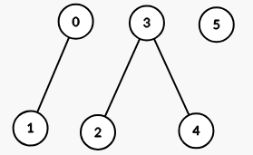
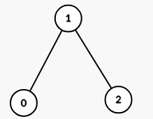

# [3493.Properties Graph][title]

## Description
You are given a 2D integer array `properties` having dimensions `n x m` and an integer `k`.

Define a function `intersect(a, b)` that returns the **number of distinct integers** common to both arrays `a` and `b`.

Construct an **undirected** graph where each index `i` corresponds to `properties[i]`. There is an edge between node `i` and node `j` if and only if `intersect(properties[i], properties[j]) >= k`, where `i` and `j` are in the range `[0, n - 1] and i != j`.

Return the number of **connected components** in the resulting graph.

**Example 1:**  



```
Input: properties = [[1,2],[1,1],[3,4],[4,5],[5,6],[7,7]], k = 1

Output: 3

Explanation:

The graph formed has 3 connected components:
```

**Example 2:**  



```
Input: properties = [[1,2,3],[2,3,4],[4,3,5]], k = 2

Output: 1

Explanation:

The graph formed has 1 connected component:
```

**Example 3:**

```
Input: properties = [[1,1],[1,1]], k = 2

Output: 2

Explanation:

intersect(properties[0], properties[1]) = 1, which is less than k. This means there is no edge between properties[0] and properties[1] in the graph.
```

## 结语

如果你同我一样热爱数据结构、算法、LeetCode，可以关注我 GitHub 上的 LeetCode 题解：[awesome-golang-algorithm][me]

[title]: https://leetcode.com/problems/properties-graph/
[me]: https://github.com/kylesliu/awesome-golang-algorithm
