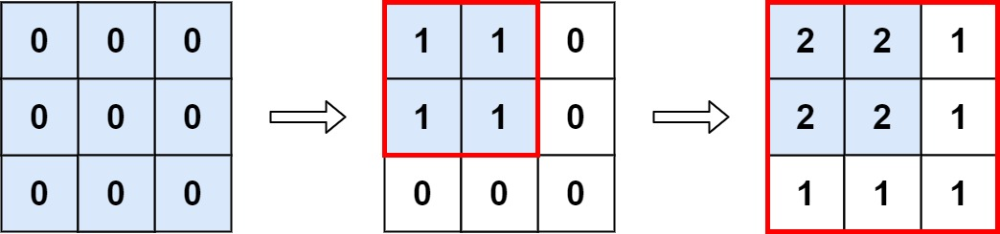

# [598.Range Addition II][title]

## Description
You are given an `m x n` matrix `M` initialized with all `0`'s and an array of operations `ops`, where `ops[i] = [ai, bi]` means `M[x][y]` should be incremented by one for all `0 <= x < ai and 0 <= y < bi`.

Count and return the number of maximum integers in the matrix after performing all the operations.

**Example 1:**  



```
Input: m = 3, n = 3, ops = [[2,2],[3,3]]
Output: 4
Explanation: The maximum integer in M is 2, and there are four of it in M. So return 4.
```

**Example 2:**

```
Input: m = 3, n = 3, ops = [[2,2],[3,3],[3,3],[3,3],[2,2],[3,3],[3,3],[3,3],[2,2],[3,3],[3,3],[3,3]]
Output: 4
```

**Example 3:**

```
Input: m = 3, n = 3, ops = []
Output: 9
```

## 结语

如果你同我一样热爱数据结构、算法、LeetCode，可以关注我 GitHub 上的 LeetCode 题解：[awesome-golang-algorithm][me]

[title]: https://leetcode.com/problems/range-addition-ii/
[me]: https://github.com/kylesliu/awesome-golang-algorithm
